# BetterCodex - Better In-Game Codex / 更好的游戏内图鉴

[CHANGELOG / 更新日志](CHANGELOG.md)

[English](#english) | [中文](#中文) | [Screenshots](#screenshots) | [截图](#截图)

> modid: Mojimoon-BetterCodex

## English

**For Brotato 1.2, the Primal Dread update (both the release and the beta).**

**Search, filters, curse / mecha / mutation previews, attack speed and price calculator. Brings the popular [web codex](https://brotato.mojimoon.top/) right into the game.**

### Features

- **Better codex overview**: badges (base price, item limit, item set), search and filters (rarity, item tag, item set, special items, weapon type / class), and items banned for you are greyed out during a run.
- **Better item details**:
  - Item tags and weapon classes under the name; click one to filter by it.
  - Related items (Hourglass → Broken Hourglass, Goldfish → Resting Goldfish, Dino Egg → Ammosaurus), click to jump.
  - **Curse preview** (10–110%). During a run, the slider highlights the curse range this wave can roll (e.g., 40-100% for wave 15).
  - **Mecha preview** for weapons.
  - **Mutation preview**: which effects can be copied (scaled by the evolution value) and which negative effects can be removed. Below the threshold it shows "Mutation too low (X/threshold)".
  - **Actual attack speed**: weapon stats show the real average cooldown instead of the original tooltip value. The **attack speed calculator** gives the randomized cooldown range, reload, DPS change and breakpoints for any attack speed, range and weapon count.
  - **Price calculator**: price at any wave, with or without Nightmare inflation.
  - During a run, everything starts at your current values (mutation, attack speed, range, weapon count, wave, difficulty).
- **Better character info** on the weapon / difficulty selection screen: preferred tags, banned items and a mutation preview; click one to view the item in the codex.
- **Better shop**:
  - Right-click an item or weapon (or hover it and press **C**, gamepad **R3**) to open it in the codex. If an owned cursed or mecha item or weapon is opened, it also shows its actual strength.
  - Mutation preview is appended to descriptions of the character and items. If mutation fruits cannot drop yet, a hint in the bottom-left corner shows how many more items are needed.
- **Better performance**: reduces the codex opening time to about 10 ms.
- Dependency-free. Supports all 13 game languages. Compatible with mods like ImprovedTooltips and BroEditor.

### Settings

You can also click **Settings** in the item / weapon codex to customize your experience:

- **Codex**:
  - Show price / item limit / item set badges (default: on)
  - **Unlock all codex entries** (does not modify your save; default: off)
- **Shop**:
  - Show bottom-left hint (default: on)
  - Right-click to jump to codex (turn off if you have other mods that use right-click; default: on)
  - Jump to codex hotkey (default: C, gamepad R3)
  - **Enable mutation preview**: default (when mutation fruits can drop) / evolution <= 0 / off

If you like this mod, please consider liking, favoriting and sharing it, thank you! Comments and suggestions are also very welcome!

<!-- BBCode

[pullquote]For Brotato 1.2, the Primal Dread update (both the release and the beta).[/pullquote]

[pullquote]Search, filters, curse / mecha / mutation previews, attack speed and price calculator. Brings the popular [url=https://brotato.mojimoon.top/]web codex[/url] right into the game.[/pullquote]

[h1]Features[/h1]

[list]
[*][b]Better codex overview[/b]: badges (base price, item limit, item set), search and filters (rarity, item tag, item set, special items, weapon type / class), and items banned for you are greyed out during a run.
[*][b]Better item details[/b]:
[list]
[*]Item tags and weapon classes under the name; click one to filter by it.
[*]Related items (Hourglass → Broken Hourglass, Goldfish → Resting Goldfish, Dino Egg → Ammosaurus), click to jump.
[*][b]Curse preview[/b] (10–110%). During a run, the slider highlights the curse range this wave can roll (e.g., 40-100% for wave 15).
[*][b]Mecha preview[/b] for weapons.
[*][b]Mutation preview[/b]: which effects can be copied (scaled by the evolution value) and which negative effects can be removed. Below the threshold it shows "Mutation too low (X/threshold)".
[*][b]Actual attack speed[/b]: weapon stats show the real average cooldown instead of the original tooltip value. The [b]attack speed calculator[/b] gives the randomized cooldown range, reload, DPS change and breakpoints for any attack speed, range and weapon count.
[*][b]Price calculator[/b]: price at any wave, with or without Nightmare inflation.
[*]During a run, everything starts at your current values (mutation, attack speed, range, weapon count, wave, difficulty).
[/list]
[*][b]Better character info[/b] on the weapon / difficulty selection screen: preferred tags, banned items and a mutation preview; click one to view the item in the codex.
[*][b]Better shop[/b]:
[list]
[*]Right-click an item or weapon (or hover it and press [b]C[/b], gamepad [b]R3[/b]) to open it in the codex. If an owned cursed or mecha item or weapon is opened, it also shows its actual strength.
[*]Mutation preview is appended to descriptions of the character and items. If mutation fruits cannot drop yet, a hint in the bottom-left corner shows how many more items are needed.
[/list]
[*][b]Better performance[/b]: reduces the codex opening time to about 10 ms.
[*]Dependency-free. Supports all 13 game languages. Compatible with mods like ImprovedTooltips and BroEditor.
[/list]

[h1]Settings[/h1]
You can also click [b]Settings[/b] in the item / weapon codex to customize your experience:
[list]
[*][b]Codex[/b]:
[list]
[*]Show price / item limit / item set badges (default: on)
[*][b]Unlock all codex entries[/b] (does not modify your save; default: off)
[/list]
[*][b]Shop[/b]:
[list]
[*]Show bottom-left hint (default: on)
[*]Right-click to jump to codex (turn off if you have other mods that use right-click; default: on)
[*]Jump to codex hotkey (default: C, gamepad R3)
[*][b]Enable mutation preview[/b]: default (when mutation fruits can drop) / evolution <= 0 / off
[/list]

[pullquote]If you like this mod, please consider liking, favoriting and sharing it, thank you! Comments and suggestions are also very welcome![/pullquote]

-->

### Screenshots

Mutation preview in the shop

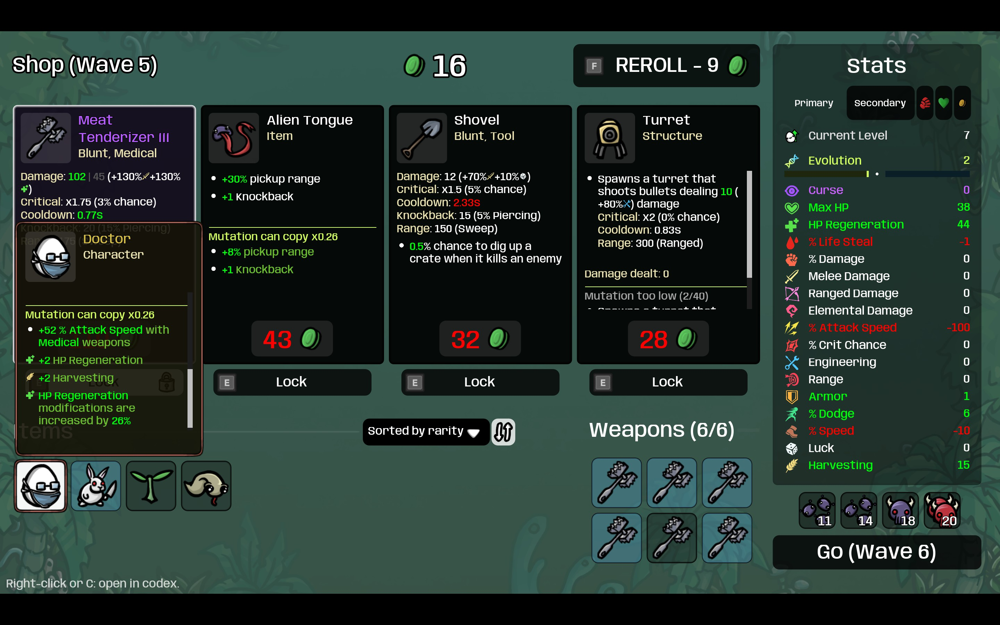

Filters, badges and the price calculator

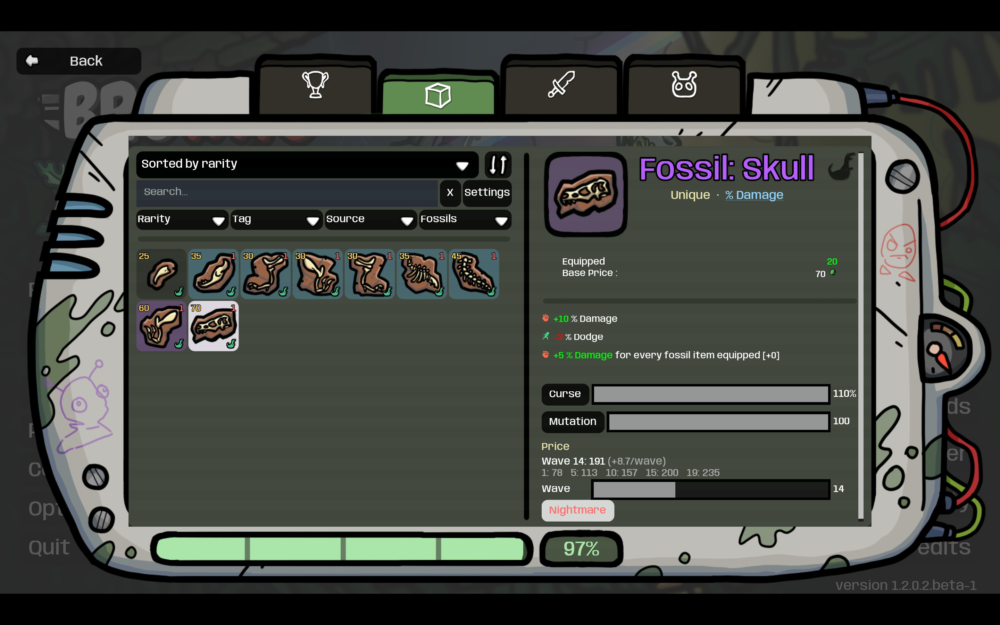

Mutation: copyable and removable effects

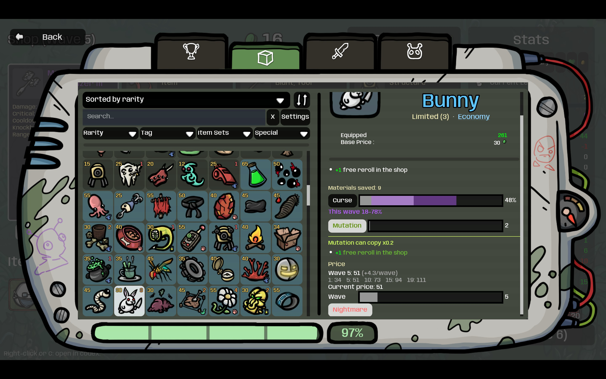

Related items and the mutation threshold

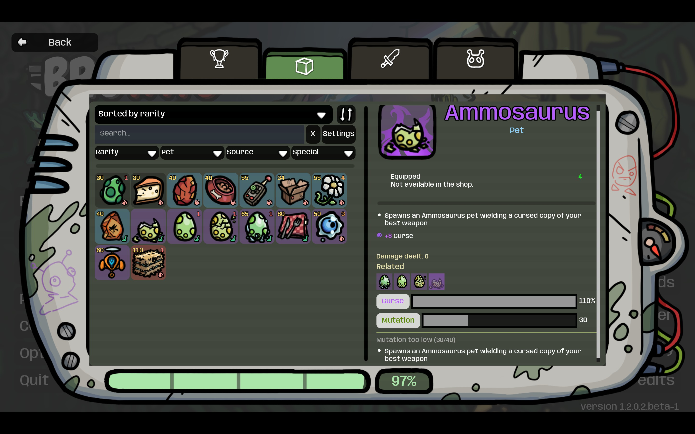

Mecha preview and the attack speed calculator

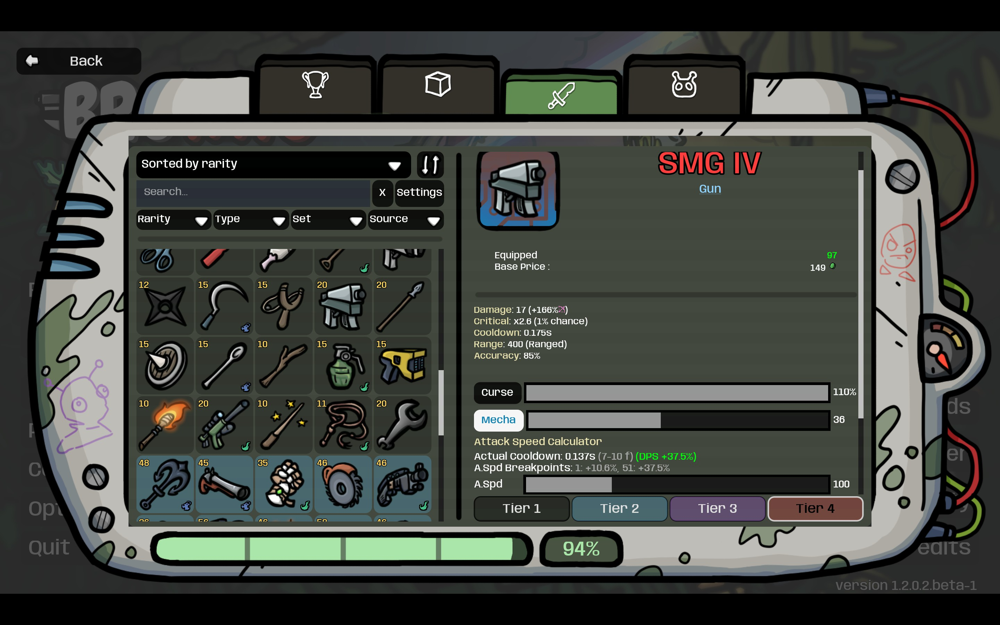

Character tags, banned items and the mutation preview

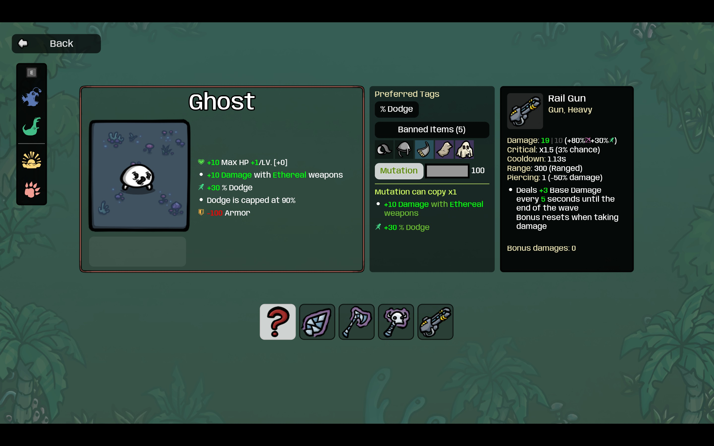

## 中文

**适用于 Brotato 1.2 史前惧兽更新（含正式版和 beta 版）。**

**筛选、搜索，诅咒、机械化、异变预览，攻速和价格计算器。将广受欢迎的 [网页图鉴](https://brotato.mojimoon.top/) 直接搬进游戏。**

### 功能

- **更好的图鉴总览**：角标（基础价格、数量上限、物品套组）、搜索和筛选（稀有度、道具标签、物品套组、特殊道具、武器类型 / 类别）、局内以灰色显示禁用道具。
- **更好的道具详情**：
  - 显示道具标签和武器类别，点击即可筛选。
  - 关联内容（沙漏→破损沙漏、金鱼→休息的金鱼、恐龙蛋→弹药恐龙），一键跳转。
  - **诅咒预览**（10–110%）。局内会在滑条上高亮本波可能出现的强度范围（例如第 15 波是 40–100%）。
  - **机械化预览**。
  - **异变预览**：查看可被复制的效果（按进化值缩放）与可被清除的负面效果。低于阈值时显示“异变不足 (X/阈值)”。
  - **实际攻速**：武器属性里的冷却显示实际平均冷却，而不是原本游戏提示里的值。**攻速计算器**给出任意攻速、范围、武器数量下的随机冷却范围、换弹、DPS 变化和攻速断点。
  - **价格计算器**：查看不同波次、难度下的价格。
  - 局内打开时，异变、攻速、范围、武器数量、波次、难度都默认取当前值。
- **更好的角色信息**：武器 / 难度选择界面显示当前角色的偏好标签、禁用道具和异变预览，点击即打开图鉴并筛选。
- **更好的商店**：
  - 右键商品或已有的武器 / 道具（或悬停后按 **C**，手柄 **R3**），在图鉴里打开它。如果是已有的诅咒或机械化武器 / 道具，还会显示它们的实际强度。
  - 角色和道具还会显示异变预览。还不能掉落异变果时，左下角提示还差几个道具。
- **更好的性能**：大幅度优化了图鉴的打开速度，只需约 10 毫秒。
- 免依赖设计，支持游戏全部 13 种语言。兼容 ImprovedTooltips 和 BroEditor 等 mod。

### 设置

你也可以在道具 / 武器图鉴里点击 **设置** 来自定义你的体验：

- **图鉴**：
  - 显示价格 / 数量上限 / 物品套组角标（默认：开）
  - **解锁全部图鉴**（不会修改存档；默认：关）
- **商店**：
  - 显示左下角提示（默认：开）
  - 右键跳转图鉴（关掉这个功能可以避免和其他 mod 的右键冲突；默认：开）
  - 跳转图鉴快捷键（默认：C，手柄 R3）
  - **启用异变预览**：默认（可掉落异变果时）/ 进化 <= 0 / 关

如果你喜欢这个 mod，欢迎点赞、收藏、转发，多谢啦！有问题或建议欢迎在评论区留言！

<!-- BBCode

[pullquote]适用于 Brotato 1.2 史前惧兽更新（含正式版和 beta 版）。[/pullquote]

[pullquote]筛选、搜索，诅咒、机械化、异变预览，攻速和价格计算器。将广受欢迎的 [url=https://brotato.mojimoon.top/]网页图鉴[/url] 直接搬进游戏。[/pullquote]

[h1]功能[/h1]

[list]
[*][b]更好的图鉴总览[/b]：角标（基础价格、数量上限、物品套组）、搜索和筛选（稀有度、道具标签、物品套组、特殊道具、武器类型 / 类别）、局内以灰色显示禁用道具。
[*][b]更好的道具详情[/b]：
[list]
[*]显示道具标签和武器类别，点击即可筛选。
[*]关联内容（沙漏→破损沙漏、金鱼→休息的金鱼、恐龙蛋→弹药恐龙），一键跳转。
[*][b]诅咒预览[/b]（10–110%）。局内会在滑条上高亮本波可能出现的强度范围（例如第 15 波是 40–100%）。
[*][b]机械化预览[/b]。
[*][b]异变预览[/b]：查看可被复制的效果（按进化值缩放）与可被清除的负面效果。低于阈值时显示“异变不足 (X/阈值)”。
[*][b]实际攻速[/b]：武器属性里的冷却显示实际平均冷却，而不是原本游戏提示里的值。 [b]攻速计算器[/b] 给出任意攻速、范围、武器数量下的随机冷却范围、换弹、DPS 变化和攻速断点。
[*][b]价格计算器[/b]：查看不同波次、难度下的价格。
[*]局内打开时，异变、攻速、范围、武器数量、波次、难度都默认取当前值。
[/list]
[*][b]更好的角色信息[/b]：武器 / 难度选择界面显示当前角色的偏好标签、禁用道具和异变预览，点击即打开图鉴并筛选。
[*][b]更好的商店[/b]：
[list]
[*]右键商品或已有的武器 / 道具（或悬停后按 [b]C[/b]，手柄 [b]R3[/b]），在图鉴里打开它。如果是已有的诅咒或机械化武器 / 道具，还会显示它们的实际强度。
[*]角色和道具还会显示异变预览。还不能掉落异变果时，左下角提示还差几个道具。
[/list]
[*][b]更好的性能[/b]：大幅度优化了图鉴的打开速度，只需约 10 毫秒。
[*]免依赖设计，支持游戏全部 13 种语言。兼容 ImprovedTooltips 和 BroEditor 等 mod。
[/list]

[h1]设置[/h1]

你也可以在道具 / 武器图鉴里点击 [b]设置[/b] 来自定义你的体验：

[list]
[*][b]图鉴[/b]：
[list]
[*]显示价格 / 数量上限 / 物品套组角标（默认：开）
[*][b]解锁全部图鉴[/b]（不会修改存档；默认：关）
[/list]
[*][b]商店[/b]：
[list]
[*]显示左下角提示（默认：开）
[*]右键跳转图鉴（关掉这个功能可以避免和其他 mod 的右键冲突；默认：开）
[*]跳转图鉴快捷键（默认：C，手柄 R3）
[*][b]启用异变预览[/b]： 默认（可掉落异变果时）/ 进化 <= 0 / 关
[/list]

[pullquote]如果你喜欢这个 mod，欢迎点赞、收藏、转发，多谢啦！有问题或建议欢迎在评论区留言！[/pullquote]

-->

### 截图

商店里的异变预览

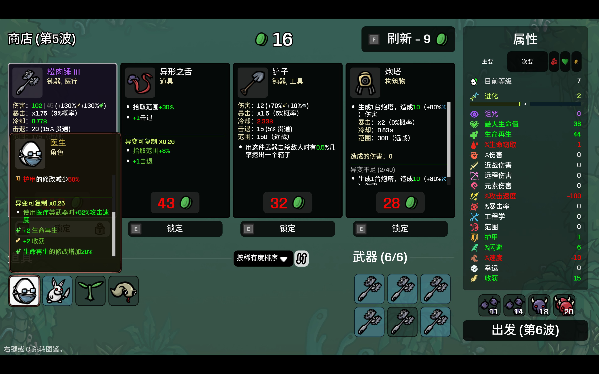

筛选、角标与价格计算

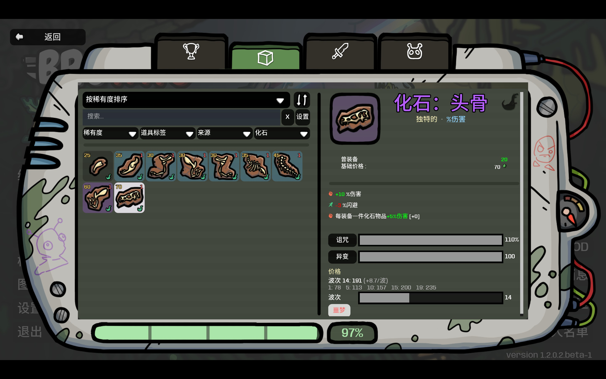

异变：可复制与可清除的效果

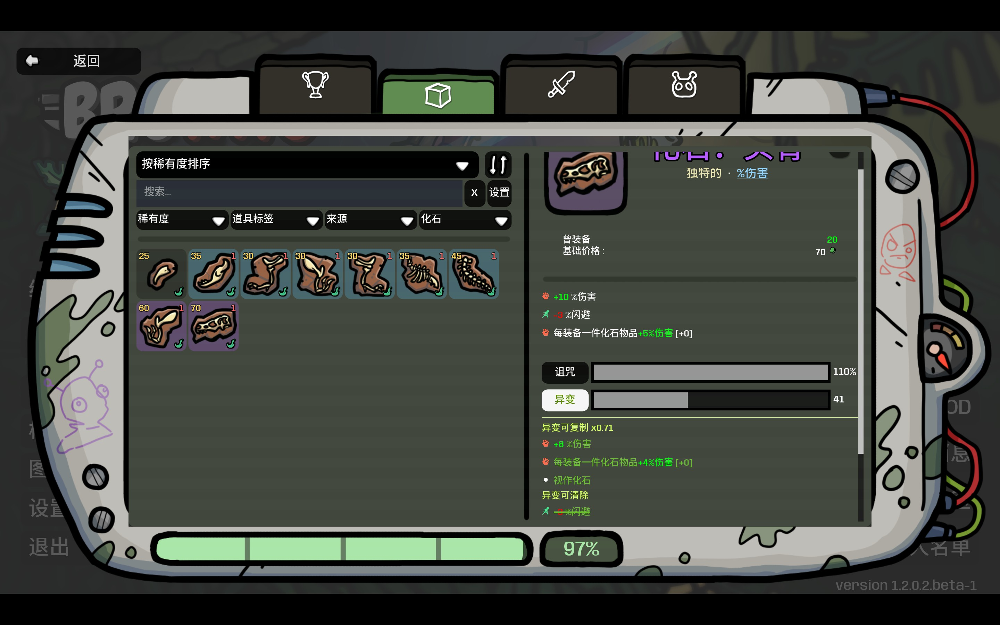

关联内容与异变阈值

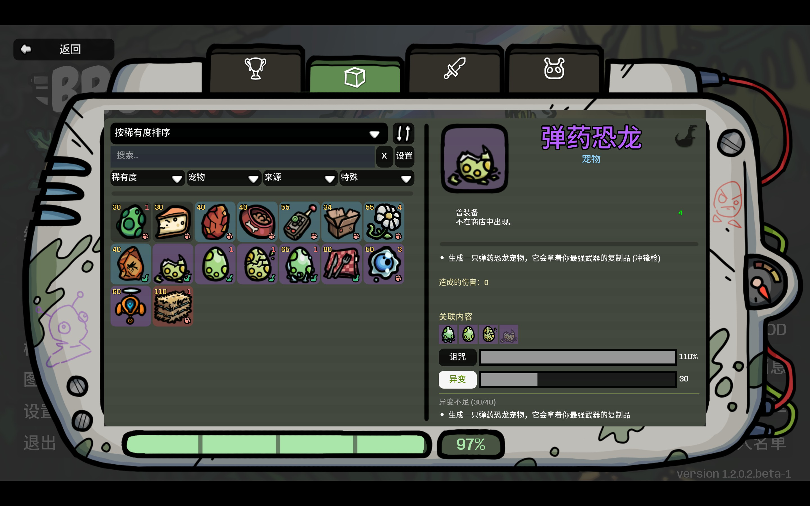

机械化预览与攻速计算器

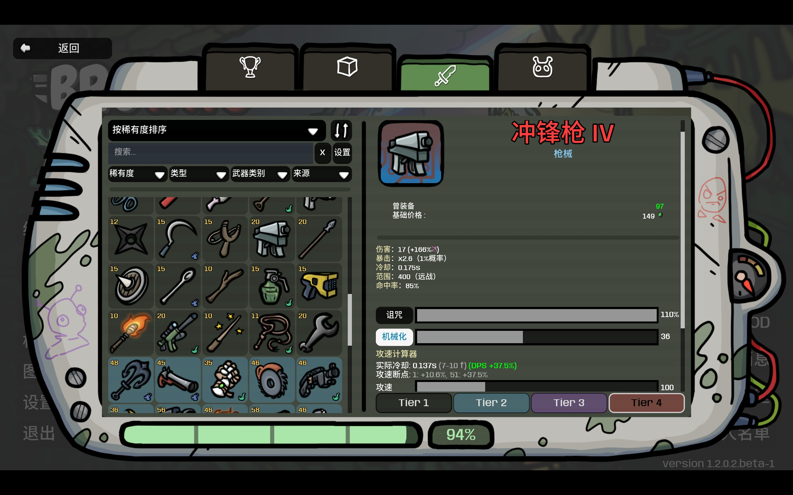

角色标签、禁用道具与异变预览

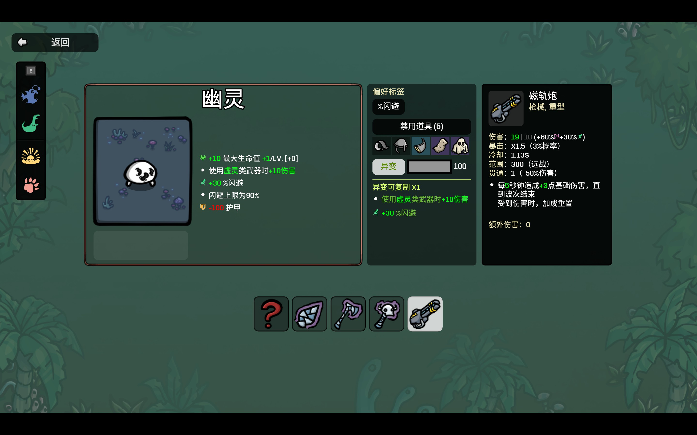
