# BroEditor - Universal Visual Editor / 万能可视化编辑器

[Steam Workshop](https://steamcommunity.com/sharedfiles/filedetails/?id=3817655214) | [Open in Steam Client](https://link.steam.watch/url/CommunityFilePage/3817655214) | [CHANGELOG / 更新日志](CHANGELOG.md)

[English](#english) | [中文](#中文) | [Screenshots](#screenshots) | [截图](#截图)

> modid: Mojimoon-BroEditor

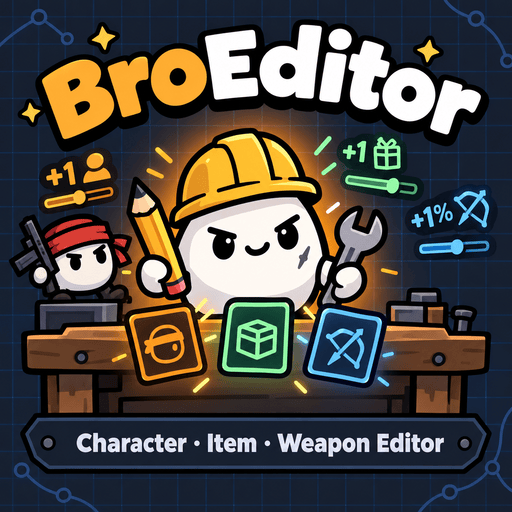

## English

**Edit any character, item or weapon, or create your own — all with in-game visual editor. No coding required.**

### Features

- **Three tabs: Characters / Items / Weapons**, each with a master switch to turn all its changes on or off, plus a fourth tab, **Workshop**.
- **Workshop**: browse, search and download packs shared by other players in one click, and upload your own edits with a title, description and image. Downloaded packs are stored separately and never overwrite your own edits: enable or disable any entry, and when the same object comes from several sources (vanilla, my edits, pack A, pack B…), pick the one to use, with a hover preview.
- **Stats**: starting stats and stat modifiers for characters; price, rarity, limit and tags for items; damage, cooldown, crit, range, projectiles, scaling and more for weapons.
- **Effects**: add any effect from every vanilla character, item and weapon, then tweak its values; drag to reorder.
- **Blueprint**: build your own effects as *trigger → condition → effect* node graphs — e.g. "own 3 items tagged X", "guarantee an item in the next shop", charm, spawn enemies.
- **Characters**: starting state (materials, levels, crates, starting wave…), starting weapons and items, **GMO (character fusion)**, banned items and weapons.
- **Create new** characters, items and weapons from any vanilla one, then DIY whatever you want. Choose an icon or import your own.
- **Disable** characters, items and weapons.
- **More and more new features**: **Lock groups** (lock characters, items and weapons as groups, or set unlock condition with blueprint), **Convenient starting weapons** (pick which characters can start with a weapon in the weapons tab), **Weapon classes** (edit or create your own classes and their bonuses) ...
- **Share** with a code (one object, a whole tab, or everything), or by sending the object's file (see below).
- Dependency free, supports all 13 game languages, compatible with all mod objects.

Heartfelt thanks to [BroLab](https://steamcommunity.com/sharedfiles/filedetails/?id=3145676266) and [Modtools](https://steamcommunity.com/sharedfiles/filedetails/?id=3672826836) for the inspiration! This mod is also compatible with their features.

### How to use

Click **BroEditor** in the top-left corner of the character, weapon or difficulty selection screen. The interface should be self-explanatory, but if you need help, click **Help** in the top-right corner.

About the buttons in the top-right corner:

- **Import**: Import a code from the clipboard to load a project, character, item, weapon or everything.
- **Export**: Export a code for the current object (BE0:), all characters (BEC:), all items (BEI:), all weapons (BEW:) or everything (BEA:). Different types have different formats, and the mod will automatically detect the type when importing from clipboard.
- **Help**: a how-to guide for the current tab (characters, items, weapons or Workshop).
- **Settings**:
  - **Font Size**: 80–125%, scales the editor's text.
  - **Effect Library Dedup**: effects with the same keys but different values count as one in the Effect Library.
  - **Hide Numbers**: by default, custom objects using vanilla icons show a number in the bottom-right corner to tell them apart. Enable this option to hide it.
  - **Show Keys**: show the key names of all stats, effects, item tags and weapon types for easy searching.
  - **Detailed Keys**: requires Show Keys. Effects show all their keys (`key (text_key) / custom_key`), and field names are shown when editing effects.

### Files

Files are saved in `%APPDATA%\Brotato\Mojimoon-BroEditor\` (Windows), `~/Library/Application Support/Brotato/Mojimoon-BroEditor/` (Mac) ,  `~/.local/share/Brotato/Mojimoon-BroEditor/` (Linux), or `/data/data/org.godotengine.brotato/files/Mojimoon-BroEditor/custom/` (Android):

- `profiles.json`: changes to vanilla characters, items and weapons, and the editor settings.
- `custom\character\`, `custom\item\`, `custom\weapon\`: one `<id>.json` file per character, item or weapon you created. To share, send the files or a whole folder; the receiver puts them in the same folder and restarts the game.
- `icons\`: imported icon images. Send them along with the file if your object uses one.
- `packs\`: packs downloaded from the Workshop, one `<id>.json` (plus its `<id>.png` thumbnail) each.
- `uploads.json`: your Workshop uploads from this computer, used to delete them later.

<!-- BBCode

[pullquote]Edit any character, item or weapon, or create your own — all with in-game visual editor. No coding required.[/pullquote]

[h1]Features[/h1]

[list]
[*][b]Three tabs[/b]: Characters / Items / Weapons, each with a master switch to turn all its changes on or off, plus a fourth tab, [b]Workshop[/b].
[*][b]Workshop[/b]: browse, search and download packs shared by other players in one click, and upload your own edits with a title, description and image. Downloaded packs are stored separately and never overwrite your own edits: enable or disable any entry, and when the same object comes from several sources (vanilla, my edits, pack A, pack B…), pick the one to use, with a hover preview.
[*][b]Stats[/b]: starting stats and stat modifiers for characters; price, rarity, limit and tags for items; damage, cooldown, crit, range, projectiles, scaling and more for weapons.
[*][b]Effects[/b]: add any effect from every vanilla character, item and weapon, then tweak its values; drag to reorder.
[*][b]Blueprint[/b]: build your own effects as *trigger → condition → effect* node graphs — e.g. "own 3 items tagged X", "guarantee an item in the next shop", charm, spawn enemies.
[*][b]Characters[/b]: starting state (materials, levels, crates, starting wave…), starting weapons and items, [b]GMO (character fusion)[/b], banned items and weapons.
[*][b]Create new[/b] characters, items and weapons from any vanilla one, then DIY whatever you want. Choose an icon or import your own.
[*][b]Disable[/b] characters, items and weapons.
[*][b]More and more new features[/b]: [b]Lock groups[/b] (lock characters, items and weapons as groups, or set unlock condition with blueprint), [b]Convenient starting weapons[/b] (pick which characters can start with a weapon in the weapons tab), [b]Weapon classes[/b] (edit or create your own classes and their bonuses) ...
[*][b]Share[/b] with a code (one object, a whole tab, or everything), or by sending the object's file (see below).
[*]Dependency free, supports all 13 game languages, compatible with all mod objects.
[/list]

Heartfelt thanks to [url=https://steamcommunity.com/sharedfiles/filedetails/?id=3145676266]BroLab[/url] and [url=https://steamcommunity.com/sharedfiles/filedetails/?id=3672826836]Modtools[/url] for the inspiration! This mod is also compatible with their features.

[h1]How to use[/h1]

Click [b]BroEditor[/b] in the top-left corner of the character, weapon or difficulty selection screen. The interface should be self-explanatory, but if you need help, click [b]Help[/b] in the top-right corner.

About the buttons in the top-right corner:

[list]
[*][b]Import / Export[/b]: export a code for the current object (BE0:), all characters (BEC:), all items (BEI:), all weapons (BEW:) or everything (BEA:). Different types have different formats, and the mod will automatically detect the type when importing from clipboard.
[*][b]Help[/b]: a how-to guide for the current tab (characters, items, weapons or Workshop).
[*][b]Settings[/b]:
[list]
[*][b]Font Size[/b]: 80–125%, scales the editor's text.
[*][b]Effect Library Dedup[/b]: effects with the same keys but different values count as one in the Effect Library.
[*][b]Hide Numbers[/b]: by default, custom objects using vanilla icons show a number in the bottom-right corner to tell them apart. Enable this option to hide it.
[*][b]Show Keys[/b]: show the key names of all stats, effects, item tags and weapon types for easy searching.
[*][b]Detailed Keys[/b]: requires Show Keys. Effects show all their keys ([i]key (text_key) / custom_key[/i]), and field names are shown when editing effects.
[/list]
[/list]

[h1]Files[/h1]

Files are saved in [i]%APPDATA%\Brotato\Mojimoon-BroEditor\[/i] (Windows), [i]~/Library/Application Support/Brotato/Mojimoon-BroEditor/[/i] (Mac) ,  [i]~/.local/share/Brotato/Mojimoon-BroEditor/[/i] (Linux), or [i]/data/data/org.godotengine.brotato/files/Mojimoon-BroEditor/custom/[/i] (Android):

[list]
[*][i]profiles.json[/i]: changes to vanilla characters, items and weapons, and the editor settings.
[*][i]custom\character\[/i], [i]custom\item\[/i], [i]custom\weapon\[/i]: one [i]<id>.json[/i] file per character, item or weapon you created. To share, send the files or a whole folder; the receiver puts them in the same folder and restarts the game.
[*][i]icons\[/i]: imported icon images. Send them along with the file if your object uses one.
[*][i]packs\[/i]: packs downloaded from the Workshop, one [i]<id>.json[/i] (plus its [i]<id>.png[/i] thumbnail) each.
[*][i]uploads.json[/i]: your Workshop uploads from this computer, used to delete them later.
[/list]

[pullquote]If you like this mod, please consider liking, favoriting and sharing it, thank you! Comments and suggestions are also very welcome![/pullquote]

GitHub repo: [url=https://github.com/mojimoon/BrotatoMods]mojimoon/BrotatoMods[/url]

-->

### Screenshots

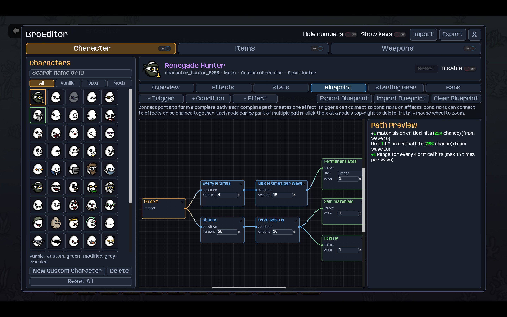

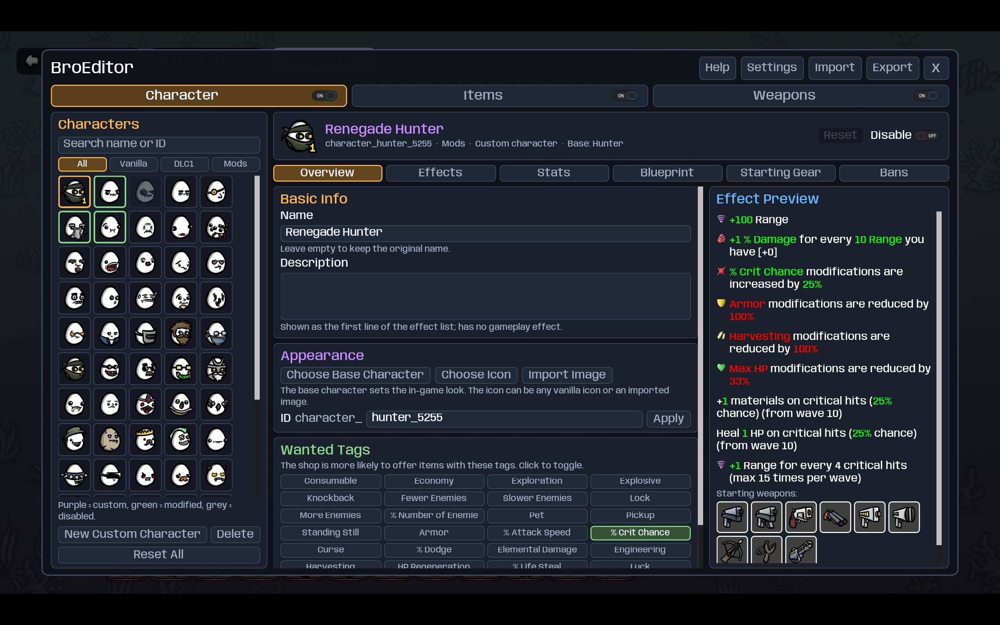

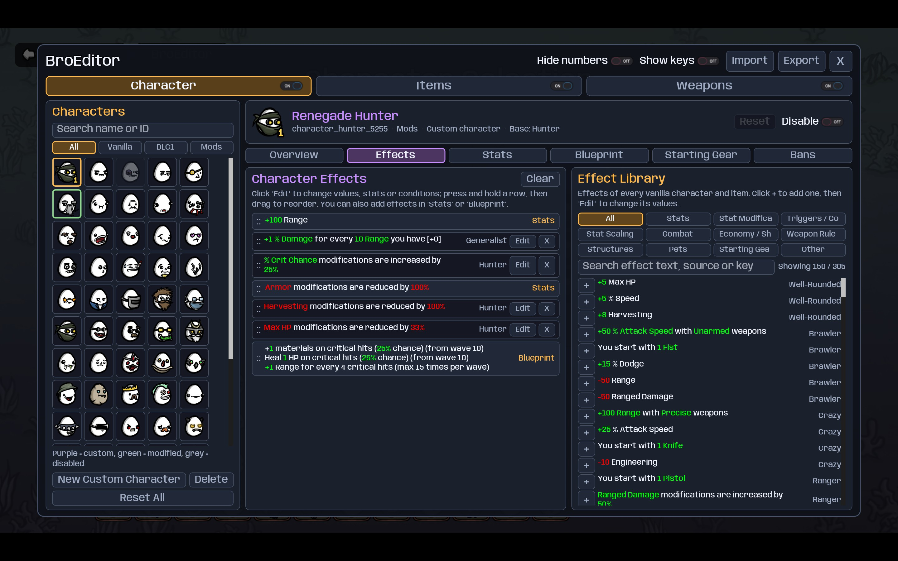

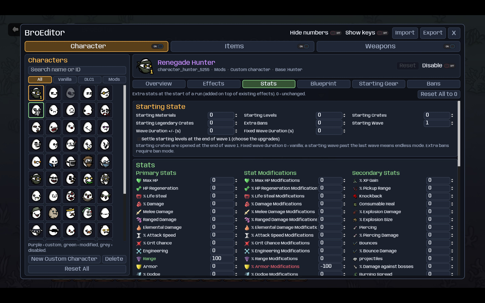

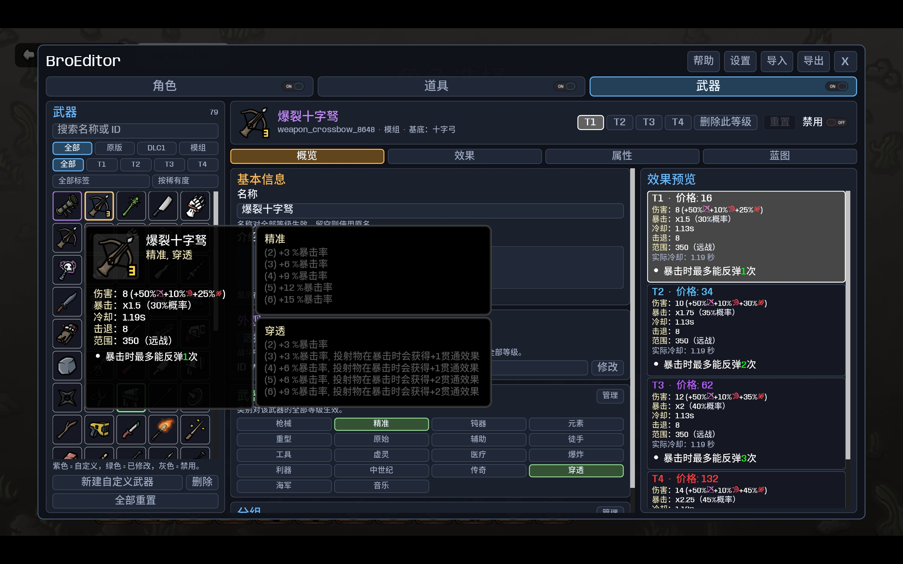

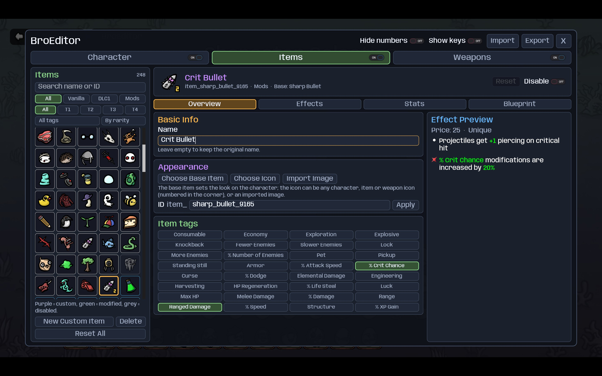

---

## 中文

**修改原版角色、道具、武器，或者原创一个——都能在游戏中可视化编辑，无需代码。**

### 功能

- **分三页：角色 / 道具 / 武器**，每页都有一个总开关，可一键启用或禁用当前页的全部修改；第四页是**工坊**。
- **工坊**：浏览、搜索其他玩家分享的数据包，一键下载；也能把自己的修改连同标题、简介、图片上传分享。下载的数据包单独保存，不会覆盖自己的修改：包内对象可逐个启用或停用；同一对象有多个来源（原版、自修改、数据包 A、数据包 B……）时，可悬停预览并选择使用哪一个。
- **属性**：角色的初始属性与属性修改%；道具的价格、稀有度、数量限制、标签；武器的伤害、冷却、暴击、范围、投射物、属性加成等……一切都能随心修改。
- **效果**：从全部原版角色、道具、武器的效果库中任选添加并修改数值和参数，拖动调整顺序。
- **蓝图**：用"触发 → 条件 → 效果"的节点图，组合出成千上万种效果，如"拥有 3 件某标签道具""下次商店必定出现某道具"、魅惑、生成敌人等。
- **角色**：开局状态（材料、等级、箱子、起始波次……）、初始武器与道具、**GMO (角色融合)**、禁用道具与武器。
- **新建**角色、道具、武器：以任意原版对象为基底，尽情 DIY。可选图标或导入图片。
- **禁用**角色、道具和武器。
- **越来越多的新特性**：**分组锁定**（把角色、道具、武器归为一组锁定，用蓝图设置解锁条件）、**便捷初始武器**（在武器页选择哪些角色可以该武器开局，智能判断等级）、**武器类别**（修改或自定义类别及加成）……
- **分享**：可以导入、导出分享码（当前项目 / 角色 / 道具 / 武器 / 全部），或以文件形式分享（见下）。
- 免依赖，支持全部 13 种语言，兼容所有 mod 内容。

万分感谢 [BroLab](https://steamcommunity.com/sharedfiles/filedetails/?id=3145676266) 和 [Modtools](https://steamcommunity.com/sharedfiles/filedetails/?id=3672826836) 提供的灵感！本 mod 也兼容它们的功能。

### 使用

在角色、武器或难度选择界面左上角点击 **BroEditor**。界面简单明了，如果有不懂的，可以点击右上角 **帮助**。

关于右上角的按钮：

- **导入 / 导出**：导出当前项目 (BE0:)、角色 (BEC:)、道具 (BEI:)、武器 (BEW:) 或全部 (BEA:) 的分享码。不同类型的格式不同，从剪贴版导入时会自动识别。
- **帮助**：显示当前栏（角色、道具、武器或工坊）的操作指南。
- **设置**：
  - **字体大小**：80–125%，控制 BroEditor 的文字大小。
  - **效果库去重**：效果库中同键名不同数值的效果视为同一条。
  - **隐藏编号**：默认情况下，使用原版图标自定义的内容右下角会显示一个编号，方便区分。启用时隐藏编号。
  - **显示键名**：显示所有属性、效果、道具标签、武器类型的内部键名 (key)，方便查找。
  - **更详细键名**：需要先开启显示键名。效果显示全部键名（`key (text_key) / custom_key`），编辑效果时额外显示字段名。

### 文件

文件保存在 `%APPDATA%\Brotato\Mojimoon-BroEditor\` (Windows)、`~/Library/Application Support/Brotato/Mojimoon-BroEditor/` (Mac) 、 `~/.local/share/Brotato/Mojimoon-BroEditor/` (Linux) 或 `/data/data/org.godotengine.brotato/files/Mojimoon-BroEditor/custom/` (Android)：

- `profiles.json`：对原版角色、道具、武器的修改，以及编辑器设置。
- `custom\character\`、`custom\item\`、`custom\weapon\`：每个新建的角色、道具、武器各一个 `<id>.json` 文件。分享时发送文件或整个文件夹，对方放进相同的文件夹后重启游戏即可。
- `icons\`：导入的图标图片。如果对象用了导入的图标，一并发送。
- `packs\`：从工坊下载的数据包，每个一个 `<id>.json`（及缩略图 `<id>.png`）。
- `uploads.json`：本机在工坊上传的记录，用于之后删除。

<!-- BBCode

[pullquote]修改原版角色、道具、武器，或者原创一个——都能在游戏中可视化编辑，无需代码。[/pullquote]

[h1]功能[/h1]

[list]
[*][b]分三页：角色 / 道具 / 武器[/b]，每页都有一个总开关，可一键启用或禁用当前页的全部修改；第四页是[b]工坊[/b]。
[*][b]工坊[/b]：浏览、搜索其他玩家分享的数据包，一键下载；也能把自己的修改连同标题、简介、图片上传分享。下载的数据包单独保存，不会覆盖自己的修改：包内对象可逐个启用或停用；同一对象有多个来源（原版、自修改、数据包 A、数据包 B……）时，可悬停预览并选择使用哪一个。
[*][b]属性[/b]：角色的初始属性与属性修改%；道具的价格、稀有度、数量限制、标签；武器的伤害、冷却、暴击、范围、投射物、属性加成等……一切都能随心修改。
[*][b]效果[/b]：从全部原版角色、道具、武器的效果库中任选添加并修改数值和参数，拖动调整顺序。
[*][b]蓝图[/b]：用"触发 → 条件 → 效果"的节点图，组合出成千上万种效果，如"拥有 3 件某标签道具""下次商店必定出现某道具"、魅惑、生成敌人等。
[*][b]角色[/b]：开局状态（材料、等级、箱子、起始波次……）、初始武器与道具、[b]GMO (角色融合)[/b]、禁用道具与武器。
[*][b]新建[/b]角色、道具、武器：以任意原版对象为基底，尽情 DIY。可选图标或导入图片。
[*][b]禁用[/b]角色、道具和武器。
[*][b]越来越多的新特性[/b]：[b]分组锁定[/b]（把角色、道具、武器归为一组锁定，用蓝图设置解锁条件）、[b]便捷初始武器[/b]（在武器页选择哪些角色可以该武器开局，智能判断等级）、[b]武器类别[/b]（修改或自定义类别及加成）……
[*][b]分享[/b]：可以导入、导出分享码（当前项目 / 角色 / 道具 / 武器 / 全部），或以文件形式分享（见下）。
[*]免依赖，支持全部 13 种语言，兼容所有 mod 内容。
[/list]

万分感谢 [url=https://steamcommunity.com/sharedfiles/filedetails/?id=3145676266]BroLab[/url] 和 [url=https://steamcommunity.com/sharedfiles/filedetails/?id=3672826836]Modtools[/url] 提供的灵感！本 mod 也兼容它们的功能。

[h1]使用[/h1]

在角色、武器或难度选择界面左上角点击 [b]BroEditor[/b]。界面简单明了，如果有不懂的，可以点击右上角 [b]帮助[/b]。关于右上角的按钮：

[list]
[*][b]导入 / 导出[/b]：导出当前项目 (BE0:)、角色 (BEC:)、道具 (BEI:)、武器 (BEW:) 或全部 (BEA:) 的分享码。不同类型的格式不同，从剪贴版导入时会自动识别。
[*][b]帮助[/b]：显示当前栏（角色、道具、武器或工坊）的操作指南。
[*][b]设置[/b]：
[list]
[*][b]字体大小[/b]：80–125%，控制 BroEditor 的文字大小。
[*][b]效果库去重[/b]：效果库中同键名不同数值的效果视为同一条。
[*][b]隐藏编号[/b]：默认情况下，使用原版图标自定义的内容右下角会显示一个编号，方便区分。启用时隐藏编号。
[*][b]显示键名[/b]：显示所有属性、效果、道具标签、武器类型的内部键名 (key)，方便查找。
[*][b]更详细键名[/b]：需要先开启显示键名。效果显示全部键名（[i]key (text_key) / custom_key[/i]），编辑效果时额外显示字段名。
[/list]
[/list]

[h1]文件[/h1]

文件保存在 [i]%APPDATA%\Brotato\Mojimoon-BroEditor\[/i] (Windows)、[i]~/Library/Application Support/Brotato/Mojimoon-BroEditor/[/i] (Mac) 、 [i]~/.local/share/Brotato/Mojimoon-BroEditor/[/i] (Linux) 或 [i]/data/data/org.godotengine.brotato/files/Mojimoon-BroEditor/custom/[/i] (Android)：

[list]
[*][i]profiles.json[/i]：对原版角色、道具、武器的修改，以及编辑器设置。
[*][i]custom\character\[/i]、[i]custom\item\[/i]、[i]custom\weapon\[/i]：每个新建的角色、道具、武器各一个 [i]<id>.json[/i] 文件。分享时发送文件或整个文件夹，对方放进相同的文件夹后重启游戏即可。
[*][i]icons\[/i]：导入的图标图片。如果对象用了导入的图标，一并发送。
[*][i]packs\[/i]：从工坊下载的数据包，每个一个 [i]<id>.json[/i]（及缩略图 [i]<id>.png[/i]）。
[*][i]uploads.json[/i]：本机在工坊上传的记录，用于之后删除。
[/list]

[pullquote]如果你喜欢这个 mod，欢迎点赞、收藏、转发，多谢啦！有问题或建议欢迎在评论区留言！[/pullquote]

GitHub 仓库：[url=https://github.com/mojimoon/BrotatoMods]mojimoon/BrotatoMods[/url]

-->

### 截图

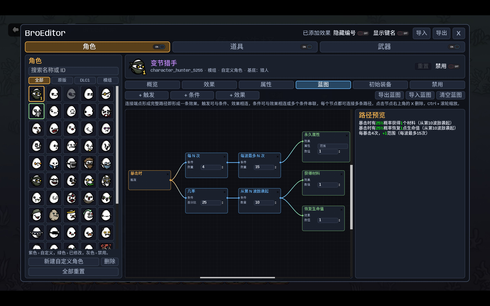

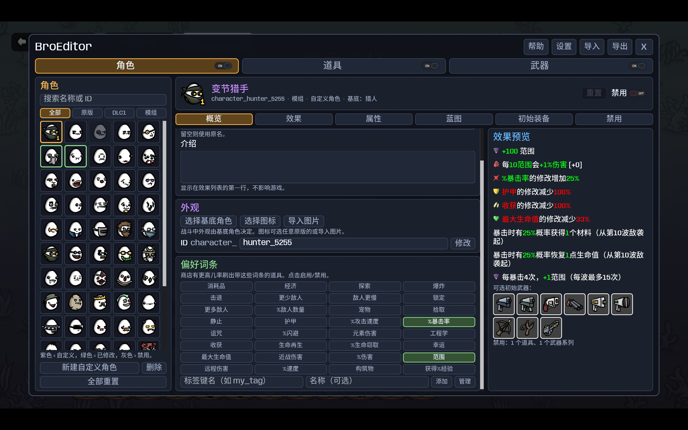

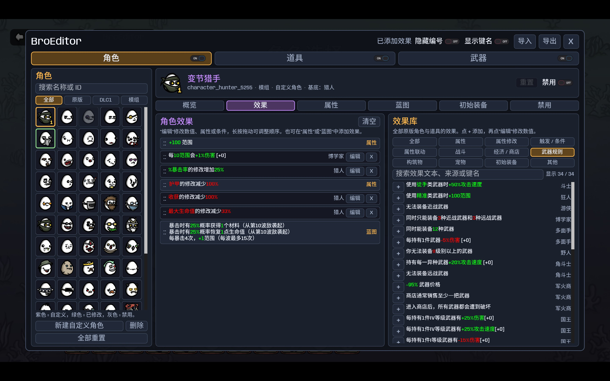

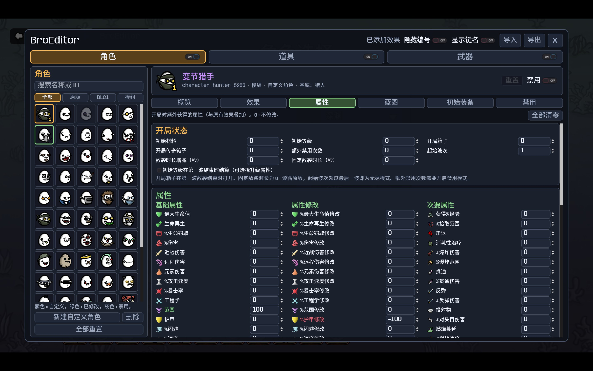

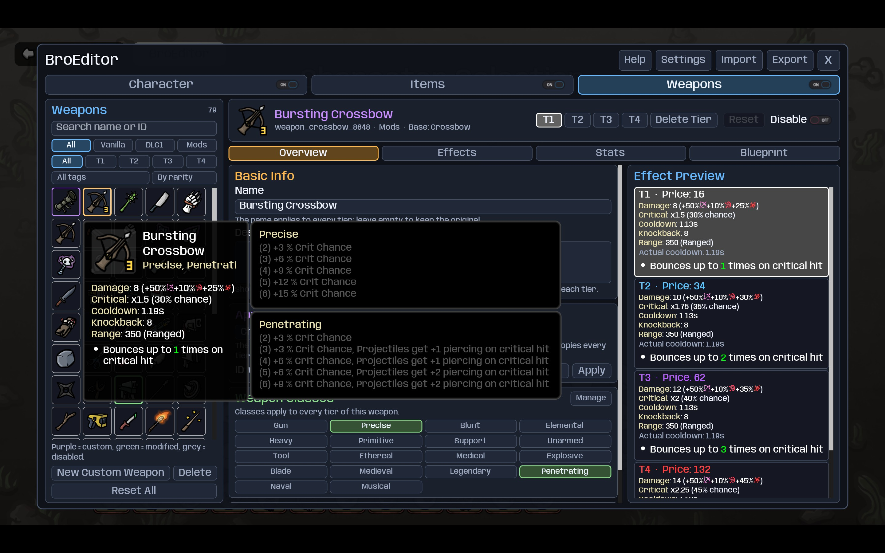

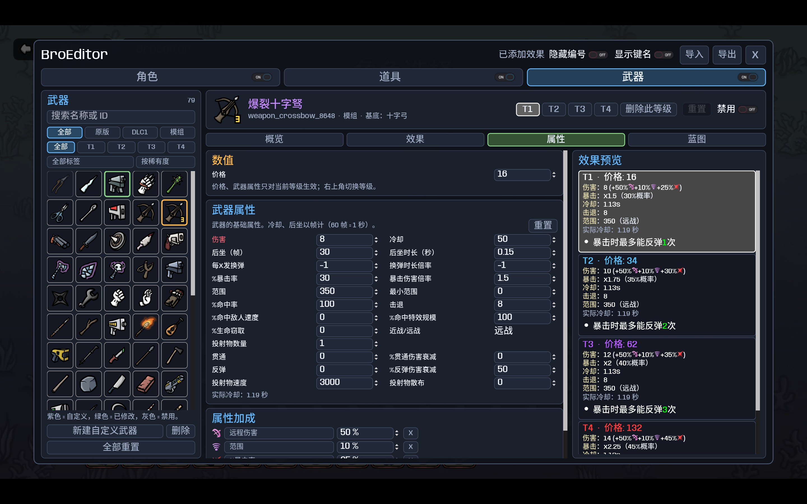

<!--

BroEditor 多功能可视化编辑器现已上线！

修改原版角色、道具、武器，或者原创一个——都能在游戏中可视化编辑，无需代码。

- 能改：角色、道具、武器。每个 Tab 都有总开关，每个对象均可单独启用或禁用。
- 什么都能改：属性、开局状态、初始武器与道具、禁用列表、价格、稀有度、数量限制、标签；武器的伤害、冷却、投射物、属性加成，每个等级分别调整。
- 效果库：全部原版角色、道具、武器的效果任选添加，再细调数值和参数。
- 蓝图：如果原版效果还满足不了你，可以用"触发 → 条件 → 效果"的节点图组合效果，二十多种触发、十几种条件，末端接任意效果。
- 自定义内容：以任意原版对象为基底，新建角色、道具和整套武器家族；可选图标或导入自己的图片。还能给原版武器补上缺少的低级版本。
- 一键分享：以分享码或文件形式分享单个对象、整页或全部内容，或者单独一张蓝图。
- 免依赖，支持游戏全部 13 种语言，兼容 BroLab 与 Modtools。

BroEditor v2.0 is out! Grand new version with many, many new features, including:

- Lock groups: set unlock conditions with blueprints
- Convenient starting weapons: pick which characters can start with a weapon in the weapons tab
- Custom weapon classes, GMO (character fusion), better effect library, and more!

If you like this mod, please consider giving a :steamthumbsup: and thank you!

BroEditor v2.0 已上线！全新版本带来更多新特性，包括：

- 分组锁定：用蓝图设置解锁条件
- 便捷初始武器：在武器页选择哪些角色可以该武器开局
- 自定义武器套装、GMO（角色融合）、更完善的效果库，还有很多！

如果喜欢，别忘了点个赞 :steamthumbsup: 支持一下，谢谢！

BroEditor 2.3 更新：工坊上线，一键分享你的创意！
▎ - 工坊：编辑器第四栏，浏览、搜索其他玩家分享的数据包，一键下载即可使用。
▎ - 上传分享：挑选你修改过的角色、道具、武器打包上传，配上标题、简介和图片；用到的武器类别、标签、其他自定义内容和图标会自动一起打包。
▎ - 互不覆盖：下载的数据包单独保存，不会动你自己的修改；包内内容可以逐个、按种类或整包启用 / 停用，卸载后一切复原。
▎ - 多来源切换：同一个角色既有你的修改、又有别人的版本？在概览页或管理页选择用原版、自修改还是某个数据包，悬停即可预览。
▎
▎ 完整内容见更新日志。快来分享你的作品，看看大家都做了什么！
欢迎在评论区反馈和提供建议！记得在工坊点赞关注谢谢喵！

BroEditor 2.3: the Workshop is here!
▎ - Workshop: a new fourth tab to browse, search and download packs shared by other players in one click.
▎ - Upload: pick the characters, items and weapons you edited and share them with a title, description and image; weapon classes, tags, other custom entries and icons they use are packed automatically.
▎ - Nothing gets overwritten: downloaded packs are stored separately from your own edits; enable or disable entries one by one, by kind or the whole pack, and uninstall to restore everything.
▎ - Switch sources: when an object comes from several places, choose vanilla, your edits or any pack on the Overview or Manage page, with a hover preview.
▎
▎ See the changelog for details. Share your creations and see what everyone else made!
If you like this mod, please consider giving a :steamthumbsup: and thank you!

--->